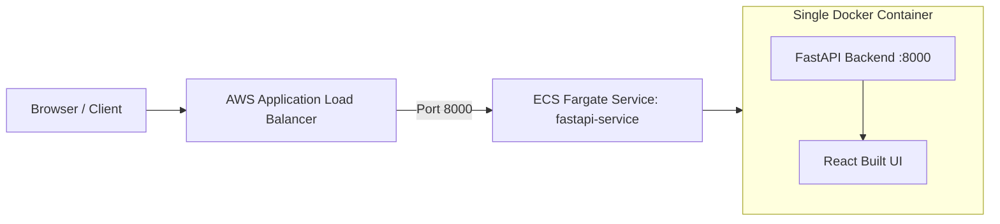

# Complete Deployment Guide: FastAPI + React App on AWS

This guide covers how to deploy the **FastAPI + React** full-stack application to **Amazon Web Services (AWS)** using the same architecture as yesterday's project.

---

## 🏗️ Architecture Overview

The app packages both the **React Frontend** and **FastAPI Backend** into a single container image:
- **FastAPI** serves the backend REST API endpoints (`/api/items`, `/health`, `/ping`) and Swagger docs (`/docs`).
- **FastAPI StaticFiles** serves the compiled React production assets from `frontend/dist/` at the root `/`.
- **Amazon ECR (ap-south-1):** Stores the Docker container image.
- **Amazon ECS (AWS Fargate):** Runs the container serverlessly.
- **Application Load Balancer (ALB):** Routes public internet traffic directly to port `8000`.



---

## 🚀 Quick Automated Deployment (Recommended)

Everything has already been pre-configured for automated CI/CD!

### Step 1: Create the GitHub Repository
1. Open your browser and go to: [https://github.com/new](https://github.com/new)
2. Repository name: **`fastapi-app`**
3. Choose **Public** (or Private).
4. **Do NOT check** "Add a README", .gitignore, or license (the local repo already has them).
5. Click **Create repository**.

### Step 2: Push the Code
In your PowerShell terminal inside `fastapi-app/`:
```powershell
git push -u origin main
```

### Step 3: Watch Deployment & Get Live URL
1. Head to your repository's **Actions** tab:  
   `https://github.com/VidyasagarJalkote/fastapi-app/actions`
2. The `CI-CD` pipeline will:
   - Run automated unit tests with `pytest`.
   - Authenticate to AWS via secure OIDC (no hardcoded credentials).
   - Build the Docker container (building the React app and installing FastAPI).
   - Push the image to Amazon ECR (`181511516422.dkr.ecr.ap-south-1.amazonaws.com/fastapi-app`).
   - Launch or update the ECS service `fastapi-service` with an Application Load Balancer.
3. Once the workflow completes, run the helper script to get your live URL:
   ```powershell
   .\start-app.ps1
   ```
   Or check the ECS console for your ALB public DNS.

---

## 🛑 Cost Management & Cleanup

To stop running containers and delete the load balancer when you're done (freezing AWS costs at \$0/hour):
```powershell
.\stop-app.ps1
```

Whenever you want to start it back up:
```powershell
.\start-app.ps1
```

---

## 🖥️ Alternative: Deploy via AWS Management Console (Manual UI)

If you prefer to deploy manually through the AWS Web Console:

### 1. Amazon ECR (Container Registry)
1. ECR repository `fastapi-app` is **already created** in `ap-south-1`.
2. Image URI: `181511516422.dkr.ecr.ap-south-1.amazonaws.com/fastapi-app:latest`

### 2. Task Definition (Container Blueprint)
1. Open **ECS Console** → **Task definitions** → **Create new task definition**.
2. **Family:** `fastapi-task`.
3. **Launch type:** `AWS Fargate` (Linux/X86_64).
4. **CPU / Memory:** `0.25 vCPU` / `0.5 GB`.
5. **Task Execution Role:** `ecsTaskExecutionRole`.
6. **Container details:**
   - **Name:** `fastapi-container`
   - **Image URI:** `181511516422.dkr.ecr.ap-south-1.amazonaws.com/fastapi-app:latest`
   - **Container Port:** `8000` (Protocol: TCP / HTTP).
7. Click **Create**.

### 3. ECS Service & Load Balancer
1. Open **ECS Console** → **Clusters** → `default`.
2. Click **Create Service**.
3. **Launch type:** `Fargate`.
4. **Task Definition:** `fastapi-task` (latest).
5. **Service name:** `fastapi-service`.
6. **Desired tasks:** `1`.
7. **Networking:**
   - VPC: Default VPC.
   - Subnets: Public subnets.
   - Security Group: Allow Inbound TCP `8000` from `0.0.0.0/0`.
8. **Load Balancing:**
   - Type: `Application Load Balancer`.
   - Health check path: `/health` (or `/ping`).
9. Click **Create**.
